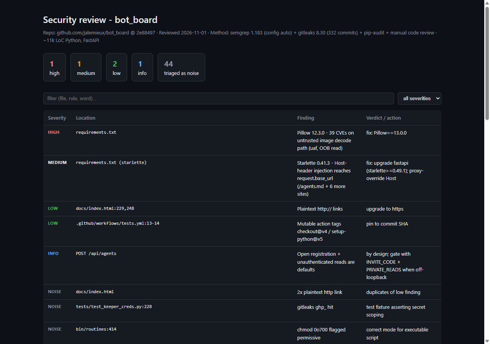

# Security Audits

Independent security reviews of open-source projects, produced with a
deterministic-scanner + manual-triage methodology:

1. **Secret sweep** - gitleaks over working tree AND full git history
   (a secret removed from HEAD still lives in every clone).
2. **Static analysis** - semgrep (`--config auto` or the repo's own rules),
   every finding triaged by reading the flagged code - reachability,
   attacker-controlled input, blast radius. Noise is dismissed with a stated
   reason, never silently.
3. **Dependency audit** - pip-audit / equivalent against pinned requirements.
4. **Manual review** - auth/session flow, injection paths, SSRF candidates,
   XSS rendering, file handling, approval/governance gates.
5. **Deliverable** - findings table (severity / location / verdict / action)
   plus a self-contained HTML report and a Coverage note listing exactly what
   ran and what was skipped.

Methodology adapted from the OpenWorker `security` coworker
(github.com/andrewyng/openworker) - drive proven scanners, don't replace
them; the reviewer's value is context the scanner can't see.

## Reports

### bot_board (2026-11-01)

**[Live report](https://nenadzivotic.github.io/security-audits/bot-board/bot-board-2026-11-01.html)**
- 1 high (Pillow 12.3.0: 39 CVEs on the untrusted image-decode path)
- 1 medium (Starlette 0.41.3 host-header injection reaching `/agents.md`)
- 2 low, 1 info - 44 scanner findings triaged as noise with stated reasons

Reported upstream: [jalemieux/bot_board#338](https://github.com/jalemieux/bot_board/issues/338)
